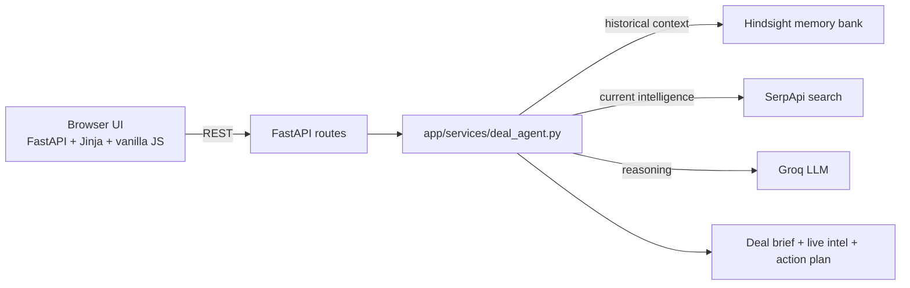

# DealPilot

DealPilot is a real-time deal intelligence agent for sales teams. It combines persistent account memory from Hindsight, current market and company signals from SerpApi, and structured reasoning from Groq to tell a salesperson what changed, why it matters, and what to do next.

## Problem

Sales teams lose valuable context between meetings: pricing objections, security requirements, stakeholder concerns, competitor comparisons, and deal risks get buried in notes and chat history. By the next call, people often have to reconstruct the story from memory and the latest market news becomes invisible to the deal conversation.

## Solution

DealPilot stores historical customer interactions in Hindsight, looks up relevant current company and market developments through SerpApi, and uses Groq to combine both streams into a concise deal brief with risk, opportunity, and recommended next action.

## Key Features

- Persistent deal memory with Hindsight
- Real-time company and market intelligence with SerpApi
- Competitor and business-signal retrieval tied to the account context
- Deal-risk detection grounded in memory + live cues
- Opportunity identification and next-best-action guidance
- Source-aware explanations for live findings
- Deal health scoring based on concrete deal evidence
- What Changed summaries that connect historical context to current signals
- Clear action recommendations built for a sales follow-up

## Architecture



## Tech Stack

- FastAPI for the API and UI serving layer
- Jinja2 templates and vanilla JavaScript for the web UI
- Hindsight for persistent deal-memory recall
- SerpApi for live company and market signals
- Groq for reasoning over memory + current information
- Python dotenv for environment configuration

## SerpApi Integration

SerpApi is a core part of the product, not a cosmetic call.

The live intelligence path is built in `app/services/serpapi_service.py` and is invoked from `app/services/deal_agent.py` immediately after Hindsight recall and before the final recommendation is generated. This allows DealPilot to:

- research the customer company and recent announcements
- pull current security, growth, pricing, leadership, and competitor developments
- prioritize searches based on the specific deal context discovered in memory
- add source-backed live signals to the final recommendation

The search strategy is not a fixed "latest company news" call. It uses deal context such as security concerns, pricing objections, competitor mentions, and ROI questions to generate targeted queries. The resulting web findings are merged with memory, then passed to Groq for final reasoning.

## Setup

Requires Python 3.11+.

```bash
cd dealpilot
python -m venv .venv
# Windows
.venv\Scripts\activate
# macOS / Linux
# source .venv/bin/activate
pip install -r requirements.txt
copy .env.example .env
```

## Environment Variables

| Variable | Required | Description |
|---|---|---|
| `HINDSIGHT_API_URL` | No | Defaults to `https://api.hindsight.vectorize.io` |
| `HINDSIGHT_API_KEY` | Yes | Hindsight API key |
| `HINDSIGHT_BANK_ID` | No | Bank name used for the persistent deal memory |
| `GROQ_API_KEY` | Yes | Groq API key |
| `GROQ_MODEL` | No | Defaults to `openai/gpt-oss-120b` |
| `SERPAPI_API_KEY` | Yes for live intelligence | SerpApi API key used for current account/company search |

Values are stored only in `.env`, which is git-ignored. The app never exposes secret values to the browser.

## Running Locally

```bash
uvicorn app.main:app --reload --port 8000
```

Then open:

```text
http://127.0.0.1:8000
```

To run the smoke check:

```bash
python scripts/smoke_test.py
```

## Demo

The demo uses an Acme Corp scenario:

1. Load the Acme demo interactions.
2. The deal history shows pricing sensitivity, security requirements, and ROI questions.
3. Ask a meeting-prep question or a deal-status question.
4. DealPilot recalls relevant memories from Hindsight.
5. It runs targeted SerpApi searches for the customer and any relevant business developments.
6. Groq combines the memory and the live signals into a deal brief, a What Changed summary, deal health, risks, opportunities, and next-best action.
7. The UI surfaces live evidence, historical context, and a concrete recommendation for the next meeting.

This can be demonstrated end-to-end in under three minutes and communicates the core hackathon story clearly: memory tells us what happened, live search tells us what changed, and Groq explains what to do next.

## Hackathon positioning

DealPilot is an existing project upgraded for a hackathon demo. It keeps the same core architecture and improves the narrative around why the combination of Hindsight + SerpApi + Groq matters for real sales work: the agent remembers what was discussed before, discovers what changed externally, and recommends what to do next.

## AI Disclosure

This project uses the following AI-related infrastructure:

- Hindsight for persistent memory retention and recall
- Groq for LLM reasoning over historical and live context
- SerpApi for live company and market intelligence retrieval
- GitHub Copilot for coding assistance and iteration support during development

The product is designed to combine these tools into one sales-intelligence workflow without replacing the existing project structure or memory system.

## API Endpoints

- `GET /health`
- `GET /api/status`
- `GET /api/deals`
- `GET /api/deals/{deal_id}`
- `POST /api/deals/{deal_id}/interactions`
- `POST /api/deals/{deal_id}/load-demo`
- `POST /api/deals/{deal_id}/ask`
- `POST /api/deals/{deal_id}/ask-without-memory`
- `GET /api/deals/{deal_id}/memories`

All error responses are safe and machine-readable, and they do not reveal secrets.
