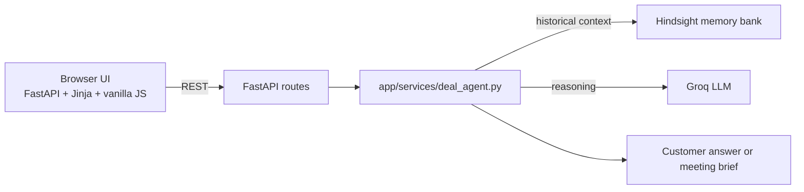

# DealPilot

DealPilot is a sales meeting assistant that combines customer-specific history from Hindsight with structured reasoning from Groq to help salespeople prepare for conversations and retain what matters.

## Problem

Sales teams lose valuable context between meetings: pricing objections, security requirements, stakeholder concerns, competitor comparisons, and deal risks get buried in notes and chat history. By the next call, people often have to reconstruct the story from memory.

## Solution

DealPilot stores customer interactions in Hindsight and uses Groq to answer questions and draft meeting briefs grounded in the selected customer's saved history.

## Key Features

- Persistent deal memory with Hindsight
- Customer-specific interaction history and persistent memory
- Meeting transcript capture with editable structured summary review
- Customer questions and meeting briefs based on saved history
- Customer workspaces with separate interaction timelines

## Architecture



## Tech Stack

- FastAPI for the API and UI serving layer
- Jinja2 templates and vanilla JavaScript for the web UI
- Hindsight for persistent deal-memory recall
- Groq for reasoning over customer history
- Python dotenv for environment configuration

## Setup

Requires Python 3.11+.

```bash
cd dealpilot
python -m venv .venv
# Windows
.venv\Scripts\activate
# macOS / Linux
# source .venv/bin/activate
pip install -r requirements.txt
copy .env.example .env
```

## Environment Variables

| Variable | Required | Description |
|---|---|---|
| `HINDSIGHT_API_URL` | No | Defaults to `https://api.hindsight.vectorize.io` |
| `HINDSIGHT_API_KEY` | Yes | Hindsight API key |
| `HINDSIGHT_BANK_ID` | No | Bank name used for the persistent deal memory |
| `GROQ_API_KEY` | Yes | Groq API key |
| `GROQ_MODEL` | No | Defaults to `openai/gpt-oss-120b` |

Values are stored only in `.env`, which is git-ignored. The app never exposes secret values to the browser.

## Running Locally

```bash
uvicorn app.main:app --reload --port 8000
```

Then open:

```text
http://127.0.0.1:8000
```

To run the smoke check:

```bash
python scripts/smoke_test.py
```

## Demo

The demo uses an Acme Corp scenario:

1. Load the Acme demo interactions.
2. The deal history shows pricing sensitivity, security requirements, and ROI questions.
3. Ask a meeting-prep question or a deal-status question.
4. DealPilot recalls relevant memories from Hindsight.
5. Groq uses the recalled customer history to answer the question or prepare a meeting brief.
6. The UI shows the answer, recalled context, and customer interaction timeline.

This can be demonstrated end-to-end in under three minutes and focuses on the core workflow: capture a customer conversation, retain its context, and prepare for the next meeting.

## Hackathon positioning

DealPilot is an existing project upgraded for a hackathon demo. It keeps the same core architecture and focuses on customer-specific persistent memory and meeting preparation.

## AI Disclosure

This project uses the following AI-related infrastructure:

- Hindsight for persistent memory retention and recall
- Groq for LLM reasoning over historical and live context
- GitHub Copilot for coding assistance and iteration support during development

The product is designed to combine these tools into one sales-intelligence workflow without replacing the existing project structure or memory system.

## API Endpoints

- `GET /health`
- `GET /api/status`
- `GET /api/deals`
- `GET /api/deals/{deal_id}`
- `POST /api/deals/{deal_id}/interactions`
- `POST /api/deals/{deal_id}/load-demo`
- `POST /api/deals/{deal_id}/ask`
- `POST /api/deals/{deal_id}/ask-without-memory`
- `GET /api/deals/{deal_id}/memories`

All error responses are safe and machine-readable, and they do not reveal secrets.
