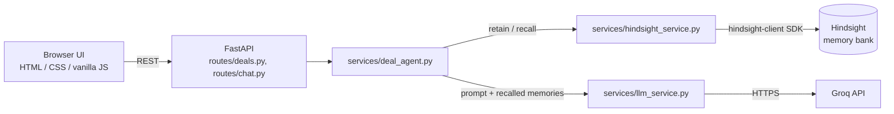

# DealPilot

**Your deals remember what you forget.**

DealPilot is a memory-powered sales intelligence agent. It stores every sales interaction in [Hindsight](https://hindsight.vectorize.io) and recalls the right memories to brief you before your next meeting.

## Problem

Deal context is scattered across meeting notes and conversations: objections, stakeholder concerns, pricing talks, competitors, requirements, commitments and unresolved issues. Before each meeting, a salesperson has to reconstruct it by hand, and things get missed.

## Solution

Paste notes after each interaction. DealPilot retains them in Hindsight. When you ask a question, or ask it to prepare you for a meeting, it recalls the relevant memories and has an LLM answer from them. The more interactions stored, the better the answers.

## Architecture



## Hindsight's role

Hindsight is the **only** memory system. All Hindsight calls are isolated in `app/services/hindsight_service.py`. The one local file, `data/interactions.json`, is a UI index used only to draw the timeline and interaction count. It is never used to answer questions.

## Flows

**Retain.** `POST /interactions` validates the text, calls Hindsight `retain` (with a deal-specific context and a unique document id), and only then adds the entry to the timeline. Hindsight extracts facts asynchronously, so new notes can take a few seconds to become searchable.

**Recall.** For a question, the agent calls Hindsight `recall`. For meeting prep and overview questions it runs four focused queries (objections, stakeholders, requirements/decisions, plus the question itself), merges and de-duplicates the results. Recalled memories are returned to the UI and shown as "Recalled from Hindsight" cards.

**LLM.** The recalled memories and the question are sent to Groq with instructions to use only those memories. Meeting prep returns structured JSON that is rendered as the Meeting Brief card. If nothing is recalled, DealPilot says so instead of calling the LLM. "Ask Without Memory" sends the same question with no memories, for the side-by-side demo.

## Setup

Requires Python 3.11+.

```bash
cd dealpilot
python -m venv .venv
source .venv/bin/activate          # Windows: .venv\Scripts\activate
pip install -r requirements.txt
cp .env.example .env               # then edit .env
```

### Environment variables

| Variable | Required | Description |
|---|---|---|
| `HINDSIGHT_API_URL` | no | Defaults to `https://api.hindsight.vectorize.io` |
| `HINDSIGHT_API_KEY` | yes | Your Hindsight API key |
| `HINDSIGHT_BANK_ID` | no | Dedicated memory bank (default `dealpilot`), created automatically |
| `GROQ_API_KEY` | yes | Your Groq API key |
| `GROQ_MODEL` | no | Defaults to `openai/gpt-oss-120b` |

Keys live only in `.env`, which is git-ignored. The UI and API never return key values.

## Run locally

```bash
uvicorn app.main:app --reload --port 8000
```

Open http://127.0.0.1:8000. Verify everything end to end with the server running:

```bash
python scripts/smoke_test.py
```

## Demo scenario

1. Click **Load Acme Demo** to retain three interactions (pricing and DataFlow, security requirements, CFO ROI ask).
2. Wait a few seconds for Hindsight to process them.
3. Ask **"Prepare me for my next Acme meeting."** and read the Meeting Brief and the recalled memory cards.
4. Scroll to **Why memory matters**. Click **Ask Without Memory**, then **Ask With Hindsight**, and compare.
5. Paste a new interaction, ask again, and watch the answer change.

## API endpoints

| Method | Path | Purpose |
|---|---|---|
| GET | `/health` | `{"status": "ok"}` |
| GET | `/api/status` | Which keys are configured (flags only) |
| GET | `/api/deals` | List deals |
| GET | `/api/deals/{deal_id}` | Deal detail, timeline, Hindsight memory count |
| POST | `/api/deals/{deal_id}/interactions` | Retain an interaction. Body: `{"content": "..."}` |
| POST | `/api/deals/{deal_id}/ask` | Recall + answer. Body: `{"question": "...", "brief": null}` |
| POST | `/api/deals/{deal_id}/ask-without-memory` | Same question, no memories |
| POST | `/api/deals/{deal_id}/load-demo` | Retain the three Acme interactions |
| GET | `/api/deals/{deal_id}/memories` | Memories recalled for the deal |

Errors return `{"error": "<safe message>", "code": "<machine code>"}`.

## Limitations

Only the `acme-corp` deal is defined (add more in `DEALS` in `deal_agent.py`). Memories for all deals share one bank, and deals are separated by name in the recall query. The timeline is local to the machine running the server.
